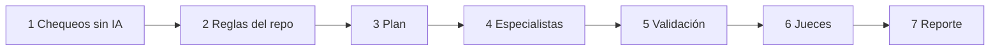

# pr-review

Primer filtro para los PRs de Bitbucket: varios agentes de Claude revisan el PR
en paralelo, otros intentan refutar lo que encontraron y el reporte final te
dice dónde mirar. No reemplaza al revisor humano y **no escribe nada en
Bitbucket**.

## Inicio rápido

```bash
go install github.com/LeanMendez/pr-reviewer/cmd/pr-review@latest
pr-review                  # abre la interfaz; la primera vez pide el workspace y los modelos
```

El binario queda en `$(go env GOPATH)/bin` (o en `GOBIN`), que tiene que estar
en el `PATH`. Desde un clon, `make build` lo deja en `bin/pr-review`.

Sin argumento usa el repo de Bitbucket de la carpeta actual o, si no hay, abre
un selector con los repos del workspace.

## Requisitos

| Herramienta | Para qué |
|---|---|
| Go 1.27 | Instalar o compilar |
| [`prb`](https://github.com/LeanMendez/prismatic-rainbow) con sesión iniciada | Leer PRs, diff y contexto de Bitbucket |
| `claude` (Claude Code) con sesión iniciada | Correr los agentes con tu suscripción; no usa clave de API |
| `git` con acceso SSH a Bitbucket | Clonar el repo para que los agentes lean el código |
| `wl-copy`, `xclip` o `xsel` (opcional) | Copiar hallazgos al portapapeles |
| `notify-send` (opcional) | Aviso de escritorio al terminar una revisión en segundo plano |

## Comandos

| Comando | Qué hace |
|---|---|
| `pr-review [repo]` | Abre la interfaz con los PRs del repo (`repo` o `workspace/repo`) |
| `pr-review review <repo> <pr> --mode <modo>` | Revisa un PR sin interfaz y escribe el reporte |
| `pr-review config models` | Abre la configuración de modelos por rol |

### Modos

| Modo | Especialistas | Jueces |
|---|---|---|
| `ligero` | bugs y reglas del repo | no |
| `exhaustivo` | bugs, seguridad, reglas, tests y contratos | no |
| `judgment` | los cuatro | dos jueces independientes con modelos distintos |

### Códigos de salida de `review`

| Código | Significado |
|---|---|
| 0 | aprobar |
| 10 | aprobar con comentarios |
| 20 | pedir cambios |
| 30 | revisar a mano (un agente falló o parte del PR quedó sin revisar) |
| 1 | error |
| 2 | error de uso |

## Cómo revisa

Go conduce siempre las mismas siete etapas; los agentes son procesos
`claude -p` aislados que solo pueden leer (`Read`, `Grep`, `Glob`).



- **Chequeos sin IA:** secretos, título sin ID de tarea, tamaño, cambios sensibles y archivos generados.
- **Reglas del repo:** el `CLAUDE.md` de la rama destino y los archivos que referencia.
- **Validación:** cada candidato grave pasa por un validador que intenta descartarlo.
- **Reporte:** separa lo que introduce el PR de lo que ya existía y, si el PR es grande, propone cómo partirlo.

## Configuración y archivos

| Qué | Dónde |
|---|---|
| Configuración | `~/.config/pr-review/config.yaml` (permisos `0600`) |
| Caché de repos | `~/.cache/pr-review/repos/<workspace>/<repo>` |
| Reportes | `<DOCUMENTS>/reviews/<repo>/pr-<N>-<fecha>/` (`xdg-user-dir DOCUMENTS`, o `~/Documentos`) |

La configuración guarda workspace, modelo y esfuerzo por rol, umbrales (400
líneas, 15 archivos), patrón del ID de tarea, concurrencia, timeout por agente
y tema. `BITBUCKET_WORKSPACE` sirve de workspace si la configuración no tiene
uno.

Cada reporte incluye `review.md`, `findings.json` (con los descartados y su
motivo), `context.json`, `pr.diff` y un log por agente.

## Desarrollo

```bash
make test   # go test ./...; no necesita red, prb ni claude
make lint   # go vet + gofmt
```

El diseño y los planes están en [`docs/superpowers/`](docs/superpowers/).

## Licencia

[MIT](LICENSE). Podés usarlo, copiarlo, modificarlo, forkearlo, distribuirlo y
venderlo, también en proyectos cerrados, siempre que conserves el aviso de
copyright y el texto de la licencia. Se entrega sin garantía.

Las paletas de algunos temas derivan de
[claude-skins](https://github.com/basicScandal/claude-skins) (MIT); ver
[`THIRD_PARTY_NOTICES.md`](THIRD_PARTY_NOTICES.md).
